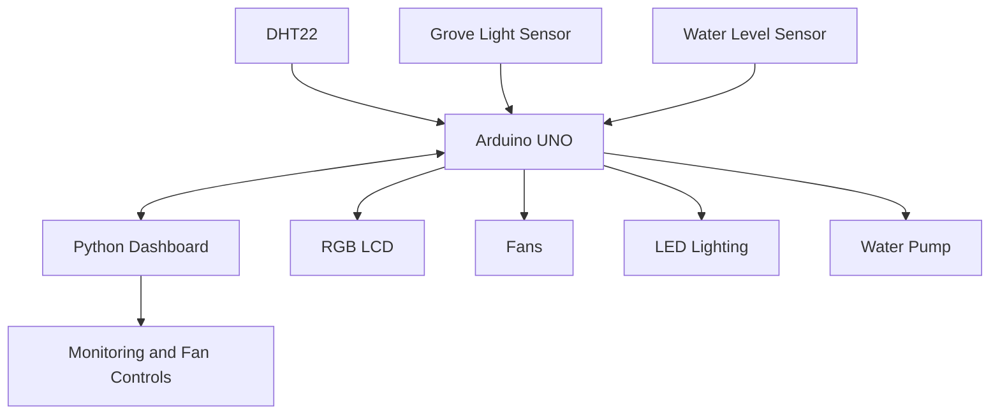

# Smart Greenhouse Automation

An Arduino-based smart greenhouse prototype designed to monitor environmental conditions and support plant care through sensors, actuators, and a Python dashboard.

## Overview

The system uses an Arduino UNO to collect environmental data and manage connected hardware. A Python dashboard displays essential readings and allows the user to control the fans.

**Key features**
- Monitor temperature and humidity.
- Monitor water level.
- Monitor light intensity.
- Turn fans on and off and adjust their speed through the dashboard.
- Automatically control LED lighting according to light conditions.
- Display environmental readings on an LCD.

## Sensors and Hardware

- **DHT22:** Measures temperature and humidity.
- **Grove Light Sensor:** Detects ambient light intensity.
- **Water Level Module Sensor:** Monitors the water level.
- **Arduino UNO:** Processes sensor readings and manages the connected components.
- **Fans:** Support ventilation and temperature regulation.
- **LEDs:** Provide lighting when needed.
- **Water pump:** Supports water circulation.
- **RGB LCD:** Displays environmental information.

## System Architecture

The Arduino reads sensor data and manages the connected hardware. The Python dashboard communicates with the Arduino over a serial connection to display readings and provide fan controls.

## Technologies

- **Hardware:** Arduino UNO, DHT22, Grove Light Sensor, water-level sensor, fans, LEDs, water pump, and RGB LCD.
- **Embedded software:** Arduino IDE and C/C++.
- **Dashboard:** Python, Tkinter, and PySerial.
- **Libraries:** DHT and RGB_LCD.

## My Contribution

I developed the Python dashboard interface for monitoring greenhouse conditions and controlling the fans. I also contributed to sensor and actuator integration, particularly the water-level sensor and fans.

## Project Report

[Read the Smart Greenhouse Project Report (PDF)](ADD_REPORT_LINK_HERE)

## Media

[View project photos and interface screenshots](media/)

*Project media will be added later.*

## Future Improvements

- Improve sensor-reading reliability and serial communication.
- Complete and validate dashboard controls.
- Add historical graphs for temperature and humidity.
- Expand automated monitoring and greenhouse control.

## Project Information

- **Degree:** Licence in Microinformatics and Embedded Systems
- **Institution:** ISAMM, Tunisia
- **Supervisor:** Mr. Smiri Kamel
- **Team:** Touka Juini, Yosr Laouiti, and Farah Htira

