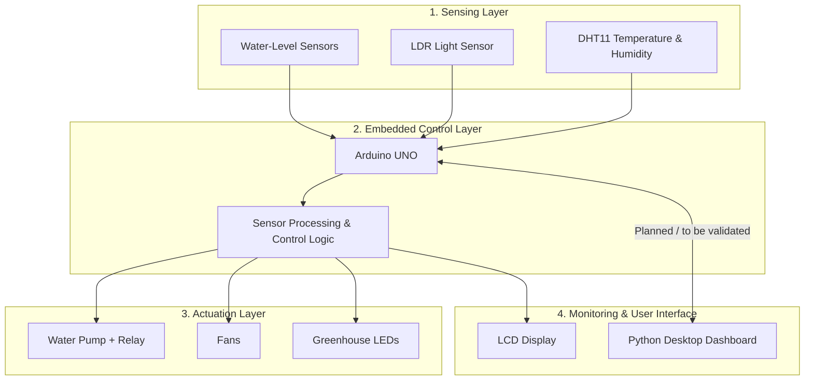

# 🌱 Smart Greenhouse Automation — SMART SERRE

An Arduino-based smart greenhouse prototype designed to monitor environmental conditions and automate essential functions, including irrigation, lighting, and climate control.

**Academic Project** · Licence in Micro-Informatique et Machines Embarquées · ISAMM, Tunisia

**Team:** Touka Juini · Yosr Laouiti · Farah Htira  
**Supervisor:** Mr. Kamel Smiri

---

## 📌 Project Overview

SMART SERRE is a smart greenhouse prototype developed to explore the use of embedded systems and automation in soilless agriculture.

The system combines environmental sensors, an Arduino UNO, actuators, an LCD display, and a Python desktop interface. It is designed to monitor temperature, humidity, light conditions, and water levels, while controlling selected greenhouse functions automatically.

The prototype demonstrates how sensor readings can be used to trigger actions such as water pumping, LED switching, and fan control.

This project was developed as an initial demonstration of the concept. Future development will focus on improving automation, reliability, and remote monitoring through a dedicated application.

## 🎯 Objectives

- Monitor greenhouse temperature and humidity.
- Detect water-level conditions and automate the irrigation pump.
- Adjust greenhouse lighting according to ambient light.
- Control fans according to environmental conditions, with provision for manual control.
- Display environmental measurements locally and through a Python desktop interface.
- Explore an embedded architecture for more efficient greenhouse management.

## ✨ Main Features

### 💧 Automated Water Management

Water-level sensors monitor the water supply in the system. Based on the programmed conditions, the Arduino activates a relay to operate the water pump.

The prototype includes logic for checking water availability and controlling pump operation.

### ☀️ Automatic Lighting

An LDR (Light Dependent Resistor) measures ambient light intensity. When the measured light level falls below the configured threshold, the Arduino switches the greenhouse LEDs on. When sufficient light is detected, the LEDs are switched off.

### 🌡️ Temperature and Humidity Monitoring

A DHT11 sensor measures temperature and relative humidity. The Arduino processes the measurements and displays them on an LCD.

### 🌬️ Fan Control

The Arduino firmware includes automatic fan-control logic based on temperature and humidity thresholds. The Python interface also includes sliders intended to provide manual fan-speed control.

### 🖥️ Python Desktop Dashboard

A graphical interface built with Python and Tkinter was designed to provide a central place for monitoring greenhouse measurements and interacting with selected actuators.

The interface includes temperature, humidity, and water-level displays, fan-speed sliders, and an LED control button.

> **Prototype note:** Some dashboard-to-Arduino communication functions remain to be completed and validated. The interface controls should not be considered fully integrated until serial communication and actuator responses have been tested.

---

## 🏗️ System Architecture

The system follows a layered embedded architecture in which sensors collect data, the Arduino applies control logic, and actuators perform the corresponding actions. The LCD and Python dashboard provide user-facing monitoring and control interfaces.

### Architecture Diagram

*The diagram represents the intended system architecture. The actual implementation and serial communication between the Arduino and Python dashboard should be verified against the current code.*

### Operating Principle

1. The sensors collect information about water levels, ambient light, temperature, and humidity.
2. The Arduino reads the available sensor measurements.
3. The programmed rules determine when the pump, fans, or LEDs should operate.
4. The LCD displays selected environmental measurements.
5. The Python desktop interface provides a graphical way to view measurements and interact with selected controls, subject to successful serial integration.

---

## 🔩 Hardware Components

| Component | Purpose |
|---|---|
| Arduino UNO | Main embedded controller |
| DHT11 sensor | Temperature and humidity measurement |
| LDR sensor | Ambient light detection |
| Water-level sensors | Monitoring water availability and level conditions |
| Water pump | Water circulation for the greenhouse |
| Relay module | Switching the water pump |
| Fans | Air circulation and climate control |
| LEDs | Supplemental greenhouse lighting |
| LCD display | Local display of environmental measurements |
| Computer | Runs the Python desktop interface |

The academic report also mentions a buzzer and smoke-detection functionality. These should be documented as implemented hardware features only after their presence and operation are confirmed in the final prototype.

## 💻 Software and Technologies

- **Arduino C/C++** — Embedded firmware and sensor/actuator control.
- **Python** — Desktop interface development.
- **Tkinter** — Graphical user interface.
- **PySerial** — Intended serial communication between the computer and Arduino.
- **DHT library** — Interface for the DHT11 sensor.
- **RGB LCD library** — LCD initialization and display control.
- **Mermaid** — System architecture documentation.

## 🧠 Implementation Details

### Arduino Firmware

The embedded firmware handles sensor reading and control logic for the greenhouse.

The integrated program includes:
- Water-level checks and pump relay control.
- Temperature and humidity acquisition through the DHT11.
- LCD display of environmental measurements.
- Light-dependent LED switching.
- Temperature- and humidity-based fan-control logic.
- Parsing of serial commands intended for manual fan-speed control.

A separate water-pump test program was also developed for the water-management subsystem.

### Python Interface

The desktop interface was designed and coded using Tkinter. It includes:
- A greenhouse dashboard window.
- Labels for temperature, humidity, and water-level information.
- Fan-speed sliders.
- An LED toggle button.
- A structure for serial communication with the Arduino.

The sensor-reading and communication routines require further integration and testing before the dashboard can be described as providing fully live monitoring and reliable remote control.

## 👩‍💻 My Contribution

My main contributions to the project included:

- **Python interface development:** Designed and coded the desktop dashboard using Tkinter.
- **Sensor and actuator integration:** Worked on the integration and control logic for selected components, including the water-level sensing subsystem and fans.
- **Control interface design:** Implemented the interface elements for displaying sensor values and adjusting fan speeds and LED state.
- **Embedded-system integration:** Contributed to connecting the monitoring interface with the Arduino-based greenhouse concept.

The project was completed collaboratively with Yosr Laouiti and Farah Htira.

## 📷 Project Gallery

The following gallery uses example paths. Replace them with the actual filenames in your repository.

### Physical Prototype

*Prototype of the SMART SERRE greenhouse system.*

### Python Desktop Interface

*Python dashboard developed for greenhouse monitoring and control.*

### System Setup

*Hardware and sensor setup used during the project.*

## 🚀 Future Improvements

The current implementation is a demonstration prototype. The next development stage would aim to build a more complete and reliable smart greenhouse system.

- **Full automation:** Improve and validate automatic irrigation and climate-control behavior.
- **Mobile application:** Develop an application for remote greenhouse monitoring and control.
- **Real-time monitoring:** Establish reliable communication between the embedded controller and the monitoring interface.
- **Alerts and notifications:** Add notifications for abnormal temperature, humidity, water-level, or gas/smoke conditions if the required sensors and logic are implemented.
- **System reliability:** Improve sensor-error handling, pump safety logic, and actuator control.
- **Data history:** Record environmental measurements over time to support analysis and optimization.

These are proposed improvements, not features of the current prototype.

## 📄 Project Report

The full academic report is available here:

[`Smart_Serre_Report.pdf`](docs/Smart_Serre_Report.pdf)

*Update this path to match the exact PDF filename in the repository.*

## 👥 Project Team

- **Touka Juini**
- **Yosr Laouiti**
- **Farah Htira**

**Academic supervisor:** Mr. Kamel Smiri

**Degree:** Licence en Micro-Informatique et Machines Embarquées  
**Institution:** ISAMM, Tunisia

---

*SMART SERRE — An academic prototype exploring embedded systems, automation, and smart agriculture.*
