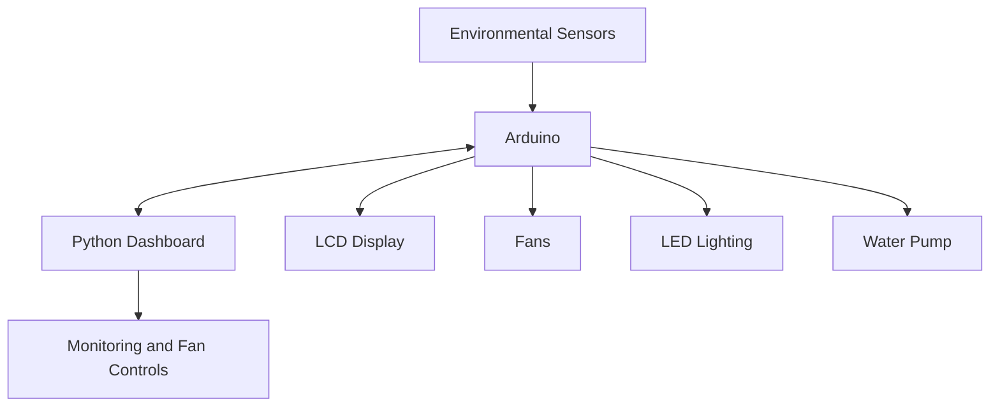

# Smart Greenhouse Automation

An Arduino-based smart greenhouse prototype designed to monitor environmental conditions and support plant care through sensors, actuators, and a Python dashboard.

## Overview

The system collects environmental data using an Arduino and displays essential readings through a desktop interface built with Python and Tkinter.

**Key features**
- Monitor temperature and humidity.
- Monitor water level.
- Turn fans on and off and adjust their speed through the dashboard.
- Automatically control LED lighting based on light conditions.
- Display environmental information on an LCD.

## System Architecture

The Arduino reads sensor data and manages connected hardware. The Python dashboard communicates with the Arduino over a serial connection to display readings and provide fan controls.

## Technologies

- **Hardware:** Arduino UNO, environmental sensors, fans, LCD, and water pump.
- **Embedded software:** Arduino IDE and C/C++.
- **Dashboard:** Python, Tkinter, and PySerial.
- **Libraries:** DHT and RGB_LCD.

## My Contribution

I worked on the Python dashboard and its interface for monitoring greenhouse conditions and controlling the fans. I also contributed to sensor and actuator integration, particularly the water-level sensor and fan controls.

## Media

[View project media](media/)

*Project photos and interface screenshots will be added later.*

## Future Improvements

- Improve reliability of sensor readings and serial communication.
- Complete and validate dashboard controls.
- Add historical graphs for temperature and humidity.
- Develop a more automated greenhouse monitoring and control system.

## Project Information

- **Degree:** Licence in Microinformatics and Embedded Systems
- **Institution:** ISAMM, Tunisia
- **Supervisor:** Mr. Smiri Kamel
- **Team:** Touka Juini, Yosr Laouiti, and Farah Htira

